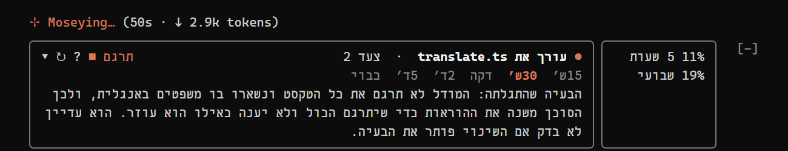
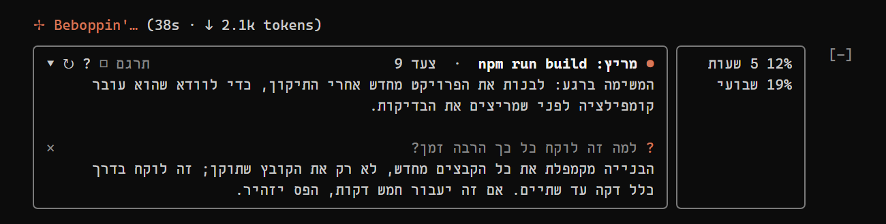
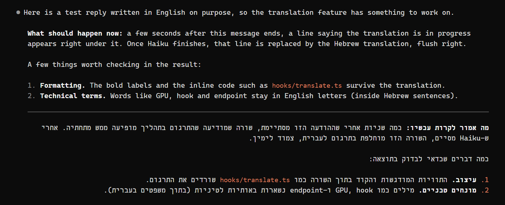

# מה קורה? · What's happening

מוד ל-Claude Code שמסביר בעברית פשוטה מה הסוכן עושה עכשיו ולמה, מסכם משימות ארוכות בשורה אחת, ומתרגם לעברית תשובות שנכתבו באנגלית.

A Claude Code mod (a plugin of function hooks) that explains, in plain Hebrew, what the agent is doing right now and why, summarises long tasks in one line, and translates mostly-English answers into Hebrew. English notes follow the Hebrew below.







## מה המוד עושה

- **פס מצב מעל שורת ההקלדה**, רק בזמן שהסוכן עובד: הפעולה הנוכחית (קורא קובץ, מריץ פקודה, עובד בדפדפן) ומספר הצעד.
- **הסברים תוך כדי עבודה**: כל כמה צעדים, לפי מרווח שבוחרים, שורה אחת בעברית שמסבירה מה הסוכן מנסה להשיג כרגע ולמה. לא "ערך קובץ X" אלא "מתקן את סדר הטעינה כדי שהמסך לא יישאר שחור". ההסברים הקודמים נפתחים בלחיצה על החץ.
- **שדה שאלה**: לחיצה על `?` פותחת שדה. מקלידים שאלה ("למה זה לוקח זמן?") ומקבלים תשובה מתוך מה שקרה במשימה עד עכשיו. השאלה והתשובה נשארות בפס (עד שלוש), וה-`×` משמאל סוגר אותן.
- **שימוש בחשבון**: אחוז הניצול של חלון 5 השעות והחלון השבועי, לצד הפס.
- **אזהרת תקיעה**: אם אותה פעולה רצה יותר מ-5 דקות, הפס מזהיר ומזכיר שאפשר לעצור עם Esc.
- **"בקצרה" אחרי משימה ארוכה**: למשימות של דקה ומעלה, שורת הסיום מוחלפת בסיכום בעברית: מה נעשה ומה נשאר.
- **תרגום לעברית**: תשובה שרובה באנגלית מקבלת מתחתיה, כעבור כמה שניות, תרגום לעברית. האנגלית נשארת, קו מפריד, ומתחתיו העברית עם כל העיצוב (רשימות, הדגשות, קוד). תשובות שכבר בעברית, גם עם מונחים באנגלית, לא מתורגמות. קוד, נתיבים וכתובות לא נספרים ולא מתורגמים.

כל הטקסטים נכתבים על ידי Claude Haiku דרך החשבון של מי שהתקין את המוד, בלי מפתח API נפרד ובלי שירות חיצוני.

## התקנה

בשורת ההקלדה של Claude Code בטרמינל:

```
/plugin install whats-happening --marketplace talarbv/claude-ma-kore
```

מאשרים את הוספת ה-marketplace עם `y`, בוחרים היקף (מומלץ: user), והמוד פעיל מיד.

מהמעטפת:

```
claude plugin install whats-happening --marketplace talarbv/claude-ma-kore
```

באפליקציית הדסקטופ: לוחצים על הפלוס ליד תיבת ההקלדה, Plugins, Add marketplace עם `talarbv/claude-ma-kore`, ואז Add plugin.

## שימוש

| מה | איך |
|---|---|
| לפתוח או לסגור את ההסברים הקודמים | החץ בתחילת הפס |
| לבחור כל כמה זמן יגיע הסבר (15 שניות עד 5 דקות, או כבוי) | הסימן `↻` בפס |
| לשאול שאלה על מה שקורה עכשיו | הסימן `?` בפס |
| להדליק או לכבות את התרגום | המתג `תרגם` בפס (ריבוע מלא: דולק, ריבוע ריק: כבוי), או הפקודה `/translate` (גם `/translate on` ו-`/translate off`) |

ההעדפות נשמרות בין סשנים.

## דרישות והערות

- Claude Code עם תמיכה במודים (function hooks). המוד נבדק על גרסה 2.1.316 בטרמינל ב-Windows.
- הפס והתרגום מצוירים בטרמינל ובאפליקציית הדסקטופ. באפליקציית הטלפון (Remote Control) הם לא מופיעים.
- עברית בטרמינל מצוירת מימין לשמאל לפי יכולות הטרמינל. בטרמינלים בלי תמיכה טובה ב-RTL הטקסט עלול להיראות הפוך.
- כל קריאה ל-Haiku נספרת בשימוש של החשבון שלכם. הקריאות קצרות (עד 300 טוקנים להסבר או לסיכום), והתרגום תלוי באורך התשובה.
- מה נשלח ל-Haiku: הבקשה שלכם, תיאור קצר של כל צעד (איזה כלי רץ ועל איזה קובץ), קטע קצר ממה שהכלי החזיר, ולתרגום: התשובה הסופית. הכל בתוך ה-API של Anthropic, כמו השיחה עצמה.

## מבנה

`hooks/register.tsx` (ה-hooks והציור), `hooks/labels.ts` (תיאור צעדים בעברית), `hooks/translate.ts` (ההחלטה מתי לתרגם והכללים לתרגום), `types/index.d.ts` (חוזה ה-state). לבדיקת תקינות: `claude plugin validate .`

## English

**What it does.** A Hebrew status band above the prompt while the agent works (current action and step count), plain-language explanations of purpose every few steps, a question field answered from the task so far, 5-hour and weekly usage, a stuck warning after 5 minutes on one action, a one-line Hebrew summary in place of the closing line of tasks over a minute, and a Hebrew translation drawn under answers whose prose is mostly English (code, paths and URLs excluded; Hebrew answers are left alone). All text is written by Claude Haiku through the installing user's own account; no API key, no third-party service.

**Install.** At the Claude Code prompt in a terminal:

```
/plugin install whats-happening --marketplace talarbv/claude-ma-kore
```

Answer `y` to add the marketplace and pick a scope (user is the usual choice). From a shell: `claude plugin install whats-happening --marketplace talarbv/claude-ma-kore`. In the desktop app: the + next to the prompt box, Plugins, Add marketplace with `talarbv/claude-ma-kore`, then Add plugin.

**Use.** The arrow in the band shows earlier explanations; `↻` picks the explanation interval (15 s to 5 min, or off); `?` opens the question field (each question and its answer stay in the band until its `×` closes them); the `תרגם` switch (filled square: on) or `/translate [on|off]` toggles the translation. Settings persist across sessions.

**Notes.** Tested on Claude Code 2.1.316, terminal, Windows. Drawn in the terminal and the desktop app, not in the mobile app. Haiku calls count against your own usage. What reaches Haiku: your prompt, a short label per step (tool and file), a short excerpt of each tool's result, and, for the translation, the final answer; all of it inside the Anthropic API, like the conversation itself.

**Validate.** `claude plugin validate .`

## רישיון · License

MIT
